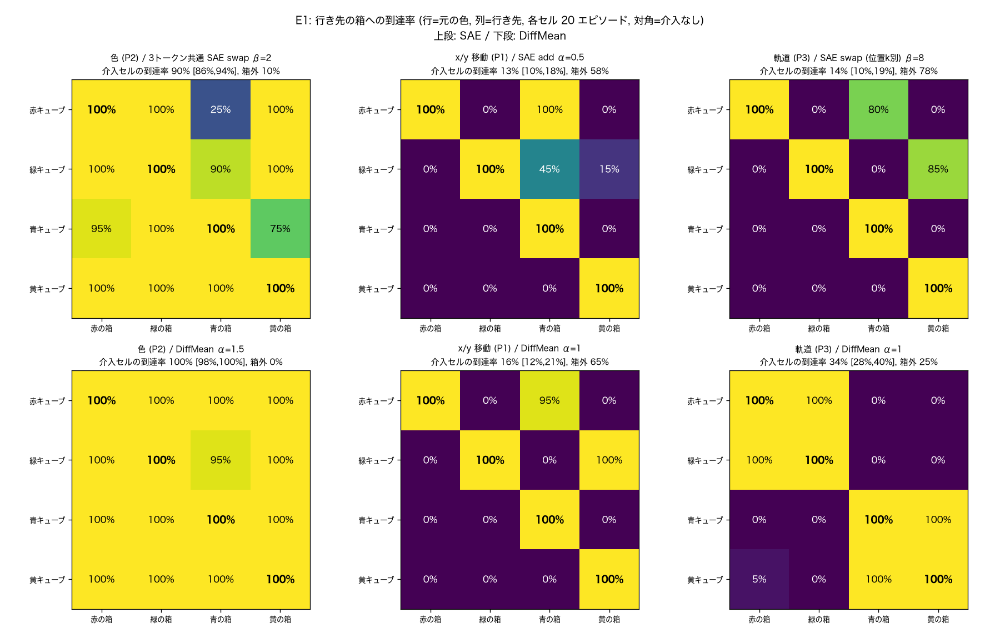
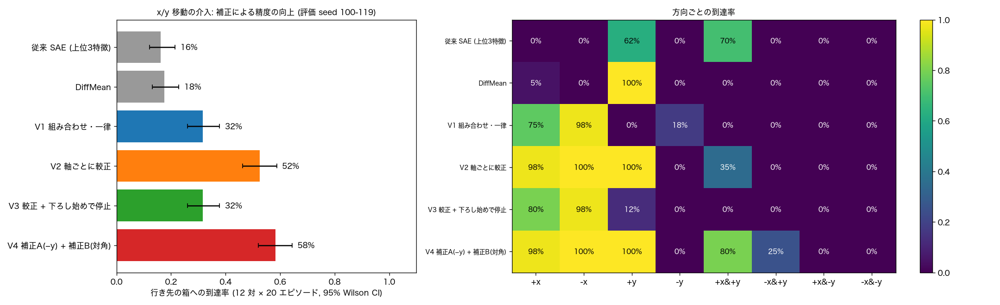

# 色キューブ仕分けタスクにおける ACT 方策への SAE 介入

Physical AI 応用編1 最終課題。robosuite 上の自作タスク（Panda がキューブを同じ色の箱へ入れる）で ACT を模倣学習し、
**学習済みの重みは固定したまま、推論時の内部表現への介入だけで**キューブを別の色の箱へ入れられるかを調べた。
介入は TopK SAE の特徴と DiffMean（平均活性の差ベクトル）で比較した。

- 説明資料: [`docs/説明資料_PAI最終課題_SachiyaFujita.pdf`](docs/説明資料_PAI最終課題_SachiyaFujita.pdf)（元の Markdown は [`docs/report.md`](docs/report.md)）
- 動画: [`docs/pai_final.mp4`](docs/pai_final.mp4)
- 実装中の判断と全数値: [`NOTES.md`](NOTES.md)、仕様: [`SPEC.md`](SPEC.md)

## 結果の要約

行き先の箱への到達率（4色 × 他の3色の箱 × 20 エピソード）:

| 介入 | SAE | DiffMean |
|---|---|---|
| ① 色（encoder の color トークン, 意図レベル） | 90%（3トークン共通）/ 94%（色の SAE） | **100%** |
| ② x/y 移動（decoder 出力, 運動レベル） | 13% → **58%**（特徴の組み合わせ選択 + 軸ごとの較正 + 対角の補正） | 18% |
| ③ 軌道（decoder の色ごとの軌道パターン特徴） | 14% | 34% |

- 学習済み ACT のベースライン成功率は 4色とも 100%。介入はすべて把持後に入れ、把持率は全条件で 100%。
- **行き先を自在に変えられるのは目的（色）の表現への介入だけ**。x/y 移動の介入は、補正すれば1軸の移動は 90〜100% 届くが、方策の目標より手前に置く方向（−y）には届かない。
- decoder 側に「4パターンの軌道」の記号は無く、軌道は x と y の成分 × 状態に応じた値で表現されていた（因果的に選んだ約 50 特徴を状態に応じた値に差し替えると 90% 切り替わるが、固定値では 2〜8%）。




## 環境
- macOS (Apple Silicon), Python 3.12, [uv](https://docs.astral.sh/uv/)
- robosuite 1.5.1, **mujoco 3.3.x**（3.17 は robosuite 1.5.1 と非互換）
- 学習は MPS（無ければ CPU）。offscreen 描画は `MUJOCO_GL=cgl`（`common.py` で既定設定）

```bash
uv sync
```

データは自作環境とスクリプト方策で生成するので、外部データのダウンロードは不要。

## 再現手順
すべて `uv run python -m pai_steer.<module>` で起動でき、`--quick`（短縮版）と `--config` を受け付ける。主要な流れは `scripts/run_all.sh`。

```bash
# データと方策
uv run python -m pai_steer.data.generate --samples         # 4色のサンプル (artifacts/samples/)
uv run python -m pai_steer.data.generate                   # 400 本 (data/cube_sort.hdf5)
uv run python -m pai_steer.policy.train_act                # ACT 学習 (30k step)
uv run python -m pai_steer.policy.eval_baseline            # E0
# SAE
uv run python -m pai_steer.sae.collect_acts                # 全フック位置の活性
uv run python -m pai_steer.sae.train_sae --site decoder_out            # 他: decoder_layer{0,1,2}, encoder_layer{0..3}
uv run python -m pai_steer.sae.train_sae --site encoder_layer0 --token color    # 色の SAE
# 特徴の同定と DiffMean
uv run python -m pai_steer.analysis.find_goal_features     # ① 色
uv run python -m pai_steer.analysis.find_xy_features --site all        # ② x/y
uv run python -m pai_steer.analysis.find_traj_features     # ③ 軌道
uv run python -m pai_steer.analysis.diffmean
# 実験
uv run python -m pai_steer.analysis.layer_study            # SAE を適用する位置の比較
uv run python -m pai_steer.steer.sweep --pattern p2        # E2 (p1, p2, p3, p1_dm, p2_dm, p3_dm)
uv run python -m pai_steer.steer.run_matrix --pattern p2 --strength 2   # E1
uv run python -m pai_steer.analysis.search_grid            # 位置 × 強度 × 特徴数の網羅探索
uv run python -m pai_steer.analysis.factor_study           # x/y・軌道 + 色の抑制
uv run python -m pai_steer.analysis.chunk_effect           # 介入による行動チャンクの変化
uv run python -m pai_steer.analysis.traj_probe             # 行き先の情報の線形 probe
uv run python -m pai_steer.analysis.find_traj_causal       # 軌道の特徴の因果的な特定
uv run python -m pai_steer.analysis.traj_causal_rollout
uv run python -m pai_steer.analysis.pattern_factor         # 4パターンの x/y 分解 (関節角度も)
uv run python -m pai_steer.analysis.xy_dose                # x/y: 強さと移動量, probing vs steering
uv run python -m pai_steer.analysis.xy_combo               # x/y: 特徴の組み合わせ選択
uv run python -m pai_steer.analysis.xy_combo_calib         # x/y: 軸ごとの較正
uv run python -m pai_steer.analysis.xy_failure             # x/y: 対角と −y の分析
uv run python -m pai_steer.analysis.xy_corrected           # x/y: 補正の検証 (評価 seed 100-119)
uv run python -m pai_steer.analysis.xy_corrected_suppress  # x/y: 補正 + 色の抑制
# 図と動画
uv run python -m pai_steer.viz.plots --e3
uv run python -m pai_steer.viz.summary
uv run python -m pai_steer.viz.pattern_videos --grid       # 条件ごとの 4×4 推論動画
uv run python -m pai_steer.viz.xy_corrected_video          # 補正版 x/y の推論動画
uv run python -m pai_steer.viz.final_video                 # 提出用の動画
uv run --with markdown python scripts/report_pdf.py docs/説明資料.pdf   # レポート PDF (Chrome が必要)
```

## ディレクトリ
```
configs/default.yaml   全パラメータ（配置・生成・学習・SAE・介入）
src/pai_steer/
  env/        CubeSortEnv（robosuite ManipulationEnv のサブクラス）, 配置と箱判定
  data/       スクリプト方策, デモ生成, Dataset
  policy/     最小 ACT（フック用の Identity: encoder_layer{i}_out, decoder_layer{i}_out, decoder_out）, 学習, ロールアウト, E0
  sae/        TopK SAE, 活性収集, 学習
  analysis/   特徴の同定, DiffMean, 位置の比較, 要因分析, x/y 介入の改善
  steer/      誤差保存の介入 hook, 並列ロールアウト, E1/E2
  viz/        描画, 図, 動画
docs/          説明資料, 図, 動画
data/, artifacts/   生成物（git 管理外）
```

## 引用
- robosuite: Y. Zhu et al., "robosuite: A Modular Simulation Framework and Benchmark for Robot Learning", arXiv:2009.12293.
- ACT: T. Z. Zhao, V. Kumar, S. Levine, C. Finn, "Learning Fine-Grained Bimanual Manipulation with Low-Cost Hardware", RSS 2023.
- MuJoCo: E. Todorov, T. Erez, Y. Tassa, "MuJoCo: A physics engine for model-based control", IROS 2012.
- TopK SAE: L. Gao et al., "Scaling and evaluating sparse autoencoders", arXiv:2406.04093.
