# 色キューブ仕分けタスクにおける ACT 方策への SAE 介入

Physical AI 応用編1 最終課題　説明資料

## 1. 概要と目的

### 1.1 背景: 学習済みの動作生成モデルの推論動作を調整したい

ロボットの動作生成では、学習済みモデルの推論動作を少しだけ調整したい場面がある。pick and place であれば、物体を置く位置を学習データより前後左右にずらしたり、運搬中の軌道を高く／低くしたりといった調整である。

動作と言語を一緒に学習した基盤モデル（VLA など）であれば、言語指示で対応できることもある。しかし、直したい動作の概念を基盤モデルが学習できていない場合や、動作データだけで学習した特化モデルのように言語でラベル付けされていない場合には、条件を少し変えるだけでも、その条件でデータを取り直して追加学習（fine-tuning など）するのが一般的である。

そこで、モデルを再学習せず、**重みは固定したまま推論時に内部の活性へ介入して動作を変える**（activation steering）という方法が考えられる。この種の手法は LLM の分野で多く提案されており、その代表例が Sparse Autoencoder（SAE）と DiffMean である。

### 1.2 SAE と DiffMean

**SAE（Sparse Autoencoder）**は、モデルの中間層の活性ベクトルを、それより次元の大きい「特徴」の空間に写し、少数の特徴だけが働く疎な表現に分解する補助モデルである。元のモデルとは別に、元のモデルの活性を再構成するように学習する。個々の特徴は「赤色」「右へ動く」のように人が解釈できる概念に対応することが多く、ある出力に対応する特徴を見つけ（probing）、その活性を推論中に強めたり弱めたりして元のモデルに戻すことで、出力を変えられる（steering）。介入するのは活性であり、元のモデルの重みは変えない。LLM では、Anthropic の研究で Claude の中間層から「ゴールデンゲートブリッジ」に対応する特徴が見つかり、この特徴を強めると何を聞いてもゴールデンゲートブリッジの話をするようになったことが示されている [Templeton et al., 2024]。本課題では、入力ごとに活性の大きい上位 k 個の特徴だけを残して疎さを直接決める TopK SAE [Gao et al., 2024] を使った。

式で書くと、TopK SAE は中間層の活性 $\mathbf{h} \in \mathbb{R}^{d}$（本課題では $d=256$）を次のように符号化・復号する。

$$
\mathbf{f} = \mathrm{TopK}_k\!\left( W_{\mathrm{enc}}\,(\mathbf{h} - \mathbf{b}_{\mathrm{pre}}) + \mathbf{b}_{\mathrm{enc}} \right) \in \mathbb{R}^{m}, \qquad
\hat{\mathbf{h}} = W_{\mathrm{dec}}\,\mathbf{f} + \mathbf{b}_{\mathrm{dec}} = \sum_{i} f_i\,\mathbf{d}_i + \mathbf{b}_{\mathrm{dec}}
$$

ここで $m$ は辞書の大きさ（本課題では 2048）、$\mathrm{TopK}_k$ は値の大きい上位 $k$ 個だけを残して（負の値は 0 にして）他を 0 にする操作、$\mathbf{d}_i$ は $W_{\mathrm{dec}}$ の第 $i$ 列（特徴 $i$ の方向を表す単位ベクトル）である。つまり活性 $\mathbf{h}$ は、$k$ 個の特徴方向 $\mathbf{d}_i$ を強さ $f_i$ で足し合わせたものとして近似される。学習では、再構成誤差 $\lVert \mathbf{h} - \hat{\mathbf{h}} \rVert_2^2$ を最小化する（ほかに、使われなくなった特徴を復活させる補助損失を小さい重みで加えた）。疎さは $k$ で直接決まるので、L1 正則化の係数を調整する必要はない。

steering では、特徴の活性 $\mathbf{f}$ を書き換えて $\mathbf{f}'$ とし（例: 特徴 $i$ を強める $f'_i = f_i + \alpha$、特徴 $j$ を消す $f'_j = 0$）、その差だけを元の活性に足し戻す。

$$
\mathbf{h}' = \mathbf{h} + W_{\mathrm{dec}}\,(\mathbf{f}' - \mathbf{f})
$$

$\hat{\mathbf{h}}$ で $\mathbf{h}$ を丸ごと置き換えるのではなく差分だけを足すので、SAE が再構成できない成分 $\mathbf{h} - \hat{\mathbf{h}}$ はそのまま残り、介入しない部分の動作は壊れない。

**DiffMean（平均差ベクトル）**は、ある概念が「ある」入力と「ない」入力（例えば赤いキューブのときと青いキューブのとき）で中間層の活性の平均を取り、その差のベクトルを推論中の活性に足す方法である [Marks & Tegmark, 2023]。式で書くと、概念がある入力の集合を $\mathcal{A}$、ない入力の集合を $\mathcal{B}$ として、

$$
\mathbf{v} = \frac{1}{|\mathcal{A}|}\sum_{\mathbf{h} \in \mathcal{A}} \mathbf{h} \;-\; \frac{1}{|\mathcal{B}|}\sum_{\mathbf{h} \in \mathcal{B}} \mathbf{h}, \qquad
\mathbf{h}' = \mathbf{h} + \alpha\,\mathbf{v}
$$

である（$\alpha$ は介入の強さ）。例えば赤を青に変えたいときは、$\mathcal{A}$ を青いキューブのときの活性、$\mathcal{B}$ を赤いキューブのときの活性にとる。SAE が「どの特徴を動かすか」を辞書から選ぶのに対し、DiffMean は2群の差という1本の方向だけを使う。学習が不要で、2群のデータだけで作れる。LLM の steering のベンチマークである AxBench では、DiffMean が SAE より高い steering 性能を示した [Wu et al., 2025]。そこで本課題では、DiffMean を SAE と比べるベースラインとして使った。

### 1.3 probing と steering のギャップ

ある出力に関わる特徴を見つけられても（probing できても）、その特徴を強めたときに狙った要素だけが変わるとは限らない。疎な特徴の空間に分解しても、1つの概念の情報が複数の特徴に少しずつ分散したり、他の概念と同じ特徴に混ざったりするため、1つの特徴を動かすと狙った方向からずれた変化（副作用）が出る。このずれを減らすために、疎さを直接制御して再構成と疎さのバランスを改善する TopK SAE [Gao et al., 2024] や、小さい辞書（粗い特徴）から大きい辞書（細かい特徴）までを入れ子にして同時に学習し、概念の分離を改善する Matryoshka SAE [Bussmann et al., 2025] などの改良が提案されている。それでも、probing と steering の間にはギャップが残ると報告されている [Wu et al., 2025]。

動作生成モデルでも、内部表現へ介入して動作を変える研究が報告されている。π0 と OpenVLA の FFN の活性から意味のある方向を取り出し、動作の速さや方向を変えた研究 [Häon et al., 2025] や、VLA に SAE を適用し、動作プリミティブに対応する特徴を強めて動作を変えた研究 [Swann et al., 2026] がある。一方で、VLA の中には汎用的な動作プリミティブに対応する特徴と、特定のエピソードを丸暗記した特徴の両方があること [Swann et al., 2026]、LLM 向けの解釈手法はそのまま VLA には移らず、SAE は疎ではあるが不完全な介入の基底であること [Jin et al., 2026] も指摘されている。パラメータの少ない特化モデルは、汎用的な動作の要素よりもデモの動作そのものを丸暗記するように学習しやすいと考えられ、その場合 steering はさらに難しくなると予想した。

### 1.4 想定する場面とタスク

生産ラインで複数種類のパーツを仕分ける作業を想定する。パーツ A は A の箱へ、パーツ B は B の箱へ運ぶデモで学習したあとに、「やはりパーツ A は B の箱の位置へ、パーツ B は A の箱の位置へ運びたい」という変更が必要になる場面である。

本課題では、パーツを4色（赤・緑・青・黄）のキューブに見立てた。机の上に色の違う4つの箱が固定位置にあり、4色のうち1色のキューブが1つ置かれている。Panda アームがキューブを掴み、キューブと同じ色の箱に入れるのがタスクである。方策には ACT（Action Chunking with Transformers）を使い、スクリプト方策で生成したデモから模倣学習した。これは、パラメータ数が少なく、動作データだけで学習した特化モデルにあたる。そのうえで、学習済みの重みは固定したまま、推論時に SAE または DiffMean で内部の活性へ介入し、「赤いキューブを緑・青・黄の箱に入れる」ことができるかを調べる。

### 1.5 目的

本課題の目的は、パラメータの少ない動作生成モデル（ACT）に SAE を適用する再現実験を行い、probing と steering のギャップがどの程度現れるかを検証することである。介入は3種類で、それぞれ SAE と DiffMean で比較する。1つ目は**色**の介入（知覚レベル）で、方策が観測したキューブの色の表現を別の色に置き換えて、運び先の箱を変える。2つ目は **x/y 移動**の介入（運動レベル）で、手先を x 方向（前後方向）や y 方向（左右方向）へずらす特徴を強める。3つ目は**軌道**の介入（運動レベル）で、4つの箱それぞれへ向かう軌道に対応する特徴を強める。これにより、「キューブが何色に見えているか」という知覚レベルの介入と、「手先をどちらへ動かすか」という運動レベルの介入とで、到達できる範囲と副作用がどう違うかを明らかにする。

## 2. 環境とデータ

### 2.1 環境

robosuite 1.5.1（MuJoCo 3.3）上に、`ManipulationEnv` を継承した自作環境 `CubeSortEnv` を作った。ロボットは Panda で、制御は OSC_POSE の差分指令、行動は位置3・回転3・グリッパー1の7次元、制御周期は 20Hz である。

配置はすべて固定で、キューブは右側の (x, y) = (0.07, −0.15) に置き、内寸 10cm の箱を左側に 2×2 で並べた（赤 (0.14, 0.10)、緑 (0.00, 0.10)、青 (0.14, 0.24)、黄 (0.00, 0.24)）。座標は robosuite の定義に従い、ロボットの土台から見て **x が前後方向（+x が奥、−x が手前）、y が左右方向（+y が左、−y が右）** である。一般的なグラフの「x = 左右、y = 前後」とは逆なので、以下では必要に応じて「y 方向（左右方向）」のように補って書く。赤の箱から見ると、緑は x 方向（前後）だけ、青は y 方向（左右）だけずれた隣にあり、黄は x と y の両方がずれた対角にある。初期状態には、キューブの xy に ±1cm、向きに ±10°、関節角に ±0.02rad のノイズを加えた。配置はサンプルを確認しながら4回修正した。Panda の可動範囲に合わせ、キューブを右・箱を左に置き、不要な手首の回転をなくし、キューブの x を箱の2列の中間にした。

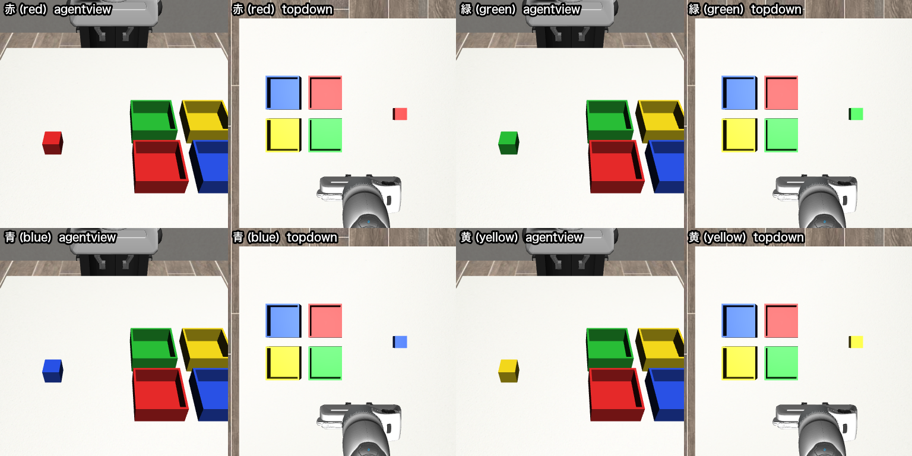

### 2.2 データ

デモは、ウェイポイント（接近 → 降下 → 把持 → 持ち上げ → 運搬 → 下降 → 離す → 退避）を手先位置の P 制御で追うスクリプト方策で生成し、新たな人手デモは集めていない。色ごとに 100本、合計 400本で、成功条件を満たした割合（採用率）は4色とも 100% だった。デモに多様性を持たせるため、ウェイポイントの xy に ±1cm のノイズ、P ゲインに 0.8〜1.2 倍のばらつき、行動にガウスノイズ（σ=0.05）を加えた。

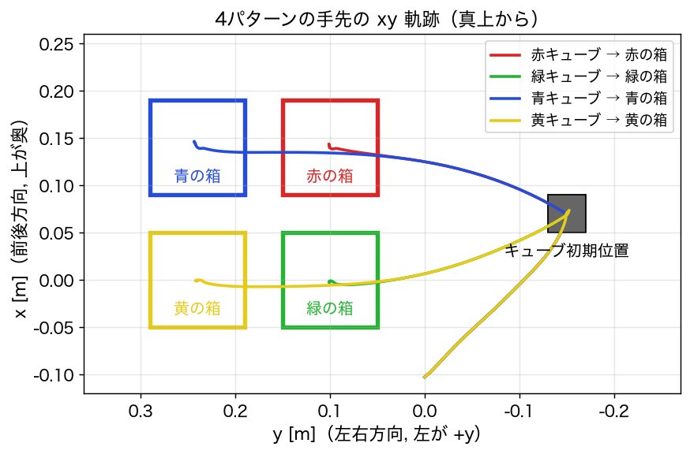

## 3. 手法

### 3.1 ACT

最小構成の ACT を自前で実装した。入力は3つのトークンで、robot トークンは手先の位置・姿勢・グリッパーの開き（9次元）、cube トークンはキューブの位置・姿勢・手先からの相対位置（10次元）、color トークンはキューブの色の one-hot（4次元）である。チャンク長は 20 で、1回の推論で実行するのは 5ステップとした。d_model は 256、encoder と decoder はそれぞれ 4層、CVAE の潜在は 32次元で、推論時は z=0 とした。Temporal Ensembling は使っていない。過去のチャンクを混ぜると介入の効果がなまり、元の動作へ戻る力が強まるためである。推論時に使うパラメータ（CVAE encoder を除く）は約 740 万、学習時に使う CVAE encoder を含めると約 1,060 万である。モデルの構成を図に示す。学習は 30k step で、MPS で約25分かかった。介入なしのベースライン（E0）では、4色とも成功率 100%（各 50エピソード、95% 信頼区間 [93%, 100%]）だった。

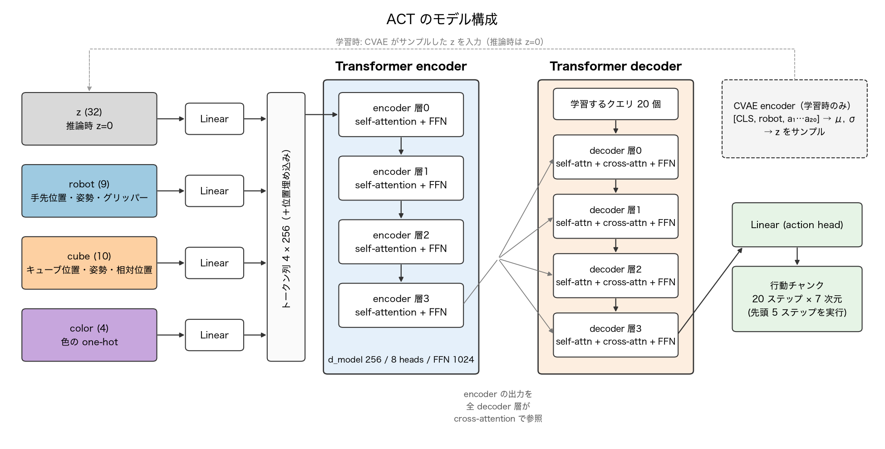

実験はすべて1台のノート PC で行った。マシンは MacBook Air（Apple M5、10 コア CPU（高性能 4 + 高効率 6）、メモリ 32GB、macOS 26.5）で、学習と推論には PyTorch 2.15 の MPS バックエンド（Apple GPU）を、シミュレーションには MuJoCo の CPU 実行を使った。外部の GPU サーバーは使っていない。

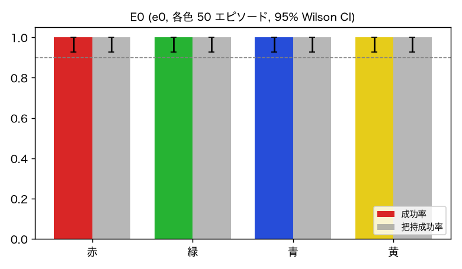

### 3.2 SAE と介入

encoder 各層の出力（4か所）と decoder 各層の出力（4か所）に、それぞれ TopK SAE（辞書 2048）を学習した。SAE は学習する活性の範囲によって次の3種類を使い分けた。

- **3トークン共通の SAE**（encoder の各層、k=16）: その層の robot・cube・color の3トークンの活性をまとめて、1つの SAE で学習した。latent トークンは推論時に常に z=0 で値が変わらないので除いた。色の特徴は color トークンの位置で選ぶが、辞書は3トークンで共有している。
- **色の SAE**（encoder の各層、k=16）: color トークンの活性だけで学習した SAE。辞書全体を色の表現に使えるので、色の特徴をよりはっきり分けられると考えて、3トークン共通の SAE と比べた。
- **decoder の SAE**（decoder の各層、k=32）: 20 個のクエリ位置の活性をまとめて学習した SAE。x/y 移動（x: 前後、y: 左右の移動）と軌道の介入に使う。

介入は 1.2 節で述べた誤差を保存する形 $\mathbf{h}' = \mathbf{h} + W_{\mathrm{dec}}(\mathbf{f}' - \mathbf{f})$ にし、SAE が再構成できない成分は壊さないようにした。比較に使う DiffMean は、平均活性の差ベクトルを足す（$\mathbf{h}' = \mathbf{h} + \alpha\mathbf{v}$）。介入は把持後（キューブを持ち上げた後）だけに入れ、そのタイミングの判定にはシミュレータの真の状態を使った。

調べた介入は次の3種類で、介入した位置を図に示す。

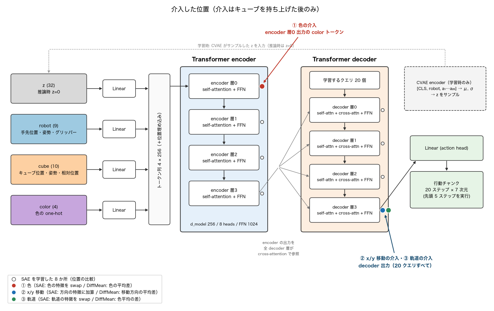

| 介入 | 位置 | SAE | DiffMean |
|---|---|---|---|
| ① 色（知覚レベル） | encoder の color トークン | 元の色の特徴を 0 にし、行き先の色の特徴をその色での平均 × β にする | μ_行き先 − μ_元 を α 倍して足す |
| ② x/y 移動（運動レベル） | decoder 出力 | +x/−x/+y/−y（奥/手前/左/右）の方向の特徴に α を足す | 手先が ±x / ±y に動くときの平均活性の差を足す |
| ③ 軌道 | decoder 出力 | 色ごと（＝軌道パターンごと）の特徴を swap する | 位置 k ごとの色平均の差を足す |

## 4. 結果と考察

実験は次の流れで進めた。まず、ACT の8か所（encoder 4層・decoder 4層の各出力）に SAE を学習し、SAE の品質と、どの位置に介入すると効くかを比べた（4.1）。次に、介入する位置・強度・特徴数を網羅的に探索しながら、3種類の介入（色・x/y 移動（x: 前後、y: 左右）・軌道）を SAE と DiffMean でそれぞれ試し、行き先の箱への到達率の上限を求めた（4.2）。そのうえで、色の介入はほぼ確実に行き先を変えられたのに、x/y と軌道の介入はほとんど効かなかった理由を考察し、改善案を立てた（4.3）。改善案は5章の追加実験で、x/y 移動の介入を対象に検証した。

### 4.1 SAE の品質と、介入する位置の比較

SAE の再構成は 8か所すべてで R² ≥ 0.97 で、SAE で置き換えても成功率は 100% のままだった。ただし、encoder の浅い層では死んだ特徴（学習データ中で一度も発火しない特徴）が 10% を超えた（層0 で 30%）。色の介入は encoder の最初の層（color トークン）が最もよく効き、深い層ほど効かなくなった。

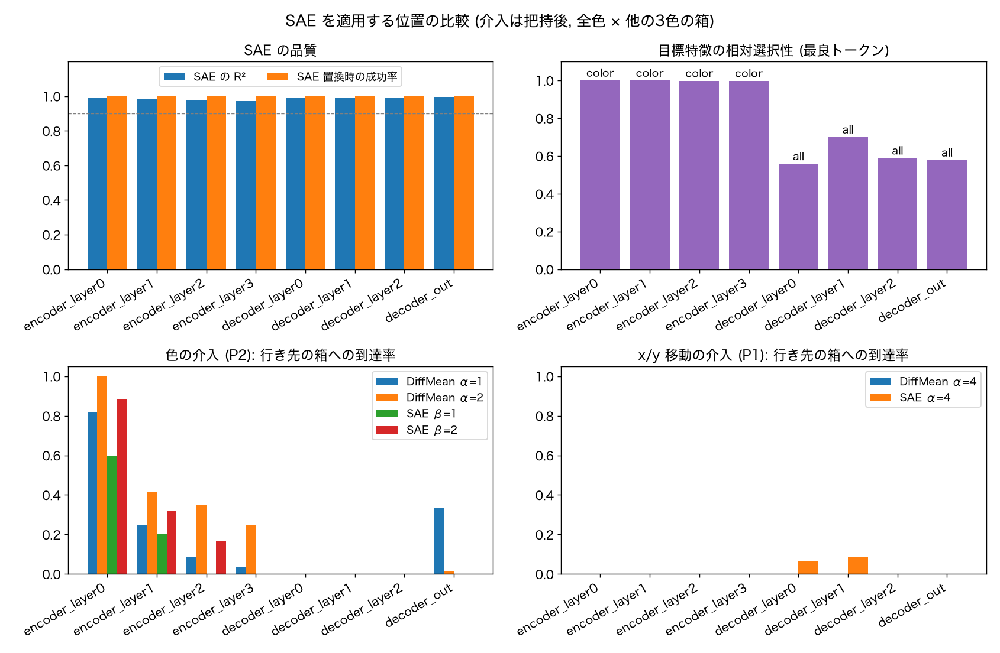

図の4つのグラフは、いずれも横軸が SAE を適用した位置（左の4つが encoder、右の4つが decoder）である。

- **左上（SAE の品質）**: 青が SAE の再構成の R²、橙が「その位置の活性を SAE の再構成で置き換えて方策を動かしたときの成功率」で、どちらも 1.0 が上限である。灰色の破線は 0.9 の目安で、すべての位置で両方とも 1.0 に近く、SAE が活性をほぼ失わずに表現できていることを示す。
- **右上（目標特徴の相対選択性）**: 各位置で「特定の色のときだけ発火する特徴」がどれだけはっきり取れるかを表す。色 $c$ の特徴の選択性を $s = \mathbb{E}[f \mid c] - \max_{c' \neq c} \mathbb{E}[f \mid c']$ とし、それを平均活性で割った値で、1 なら他の色ではまったく発火しない。棒の上の文字は、その位置で最も選択性が高かったトークン（color = color トークン、all = 全トークン）である。encoder では color トークンにほぼ完全に色専用の特徴があるが、decoder では 0.6〜0.7 にとどまり、色の情報が他の情報と混ざっていることが分かる。
- **左下（色の介入の到達率）**: 各位置で色の介入を行ったときの、行き先の箱への到達率である。色ごとの棒は手法と強度（SAE は β、DiffMean は α）の違いを表す。encoder 層0 が最も高く、層が深くなるほど下がる。decoder では、DiffMean（α=1）を decoder 出力に入れた場合の 33% を除いて、ほとんど効かない。
- **右下（x/y 移動の介入の到達率）**: x/y 移動の特徴は、手先のこれからの移動と相関する特徴として decoder 側で選んだので、decoder の位置でだけ試した。どの位置でも到達率は 10% 未満だった。

この結果から、色の介入は encoder 層0 の color トークン、x/y 移動と軌道の介入は decoder 出力を主な位置とし、4.2 ではその周りも含めて探索した。

### 4.2 網羅探索による3種類の介入の比較

介入する位置（色は encoder の4層、x/y と軌道は decoder の4層）× 強度（4〜5段階）× SAE で使う特徴の数（1, 3, 5, 10, 20）を組み合わせて、合計 166通り（9960エピソード）を試した。各条件は、4色 × 他の3色の箱 × 5 seed の 60エピソードで評価した。下表は、各介入・手法で最も到達率が高かった条件の結果である（括弧内は 95% 信頼区間）。

| 介入 | 手法 | 最高到達率 | そのときの条件 |
|---|---|---|---|
| ① 色 | SAE（3トークン共通） | 95% [86%, 98%] | encoder 層0、色ごとに 10 特徴、β=2 |
| ① 色 | SAE（色の SAE） | 95% [86%, 98%] | encoder 層0、色ごとに 5 特徴、β=3 |
| ① 色 | DiffMean | **100%** [94%, 100%] | encoder 層0、α=1.5 |
| ② x/y 移動 | SAE | 18% [11%, 30%] | decoder 出力、方向ごとに 5 特徴、α=0.5 |
| ② x/y 移動 | DiffMean | 17% [9%, 28%] | decoder 出力、α=2 |
| ③ 軌道 | SAE | 22% [13%, 34%] | decoder 出力、色 × 位置 k ごとに 5 特徴、β=16 |
| ③ 軌道 | DiffMean | 35% [24%, 48%] | decoder 層2、α=4 |

色の介入は、エピソードの最初から入れても把持は崩れず、行き先だけが変わった。一方、x/y と軌道の介入は、位置・強度・特徴数をどう選んでも到達率が上がらず、探索の範囲を広げても x/y は最高 18%、軌道は最高 35% にとどまった。

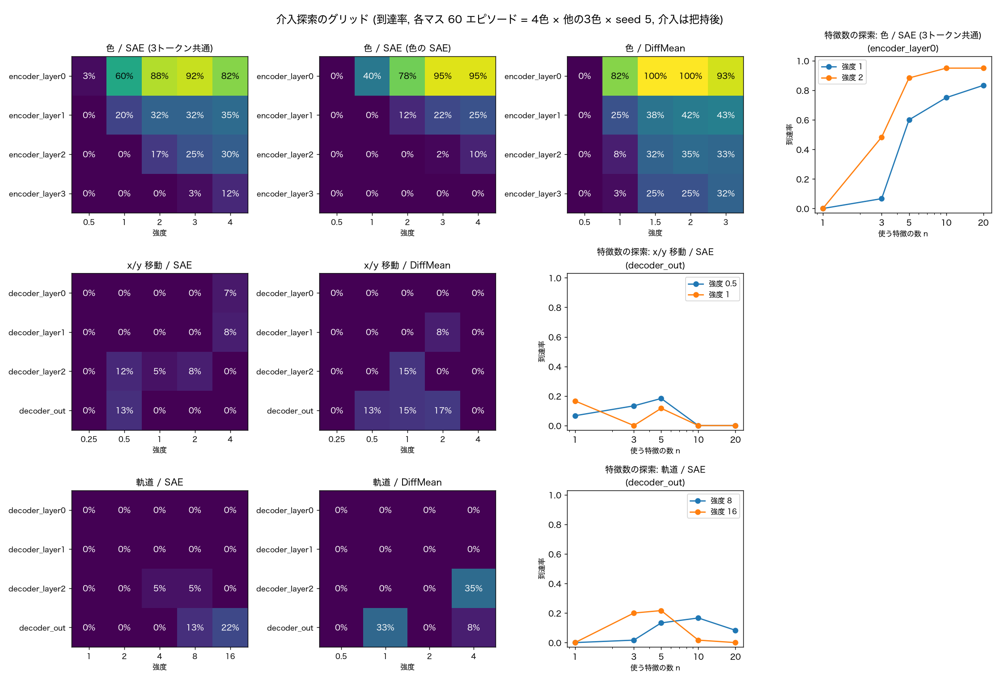

SAE の介入で刺激した特徴を下図に示す。辞書の 2048 個の特徴を横一列に並べ、各行（色、または移動方向）で刺激した特徴に色を付けた。

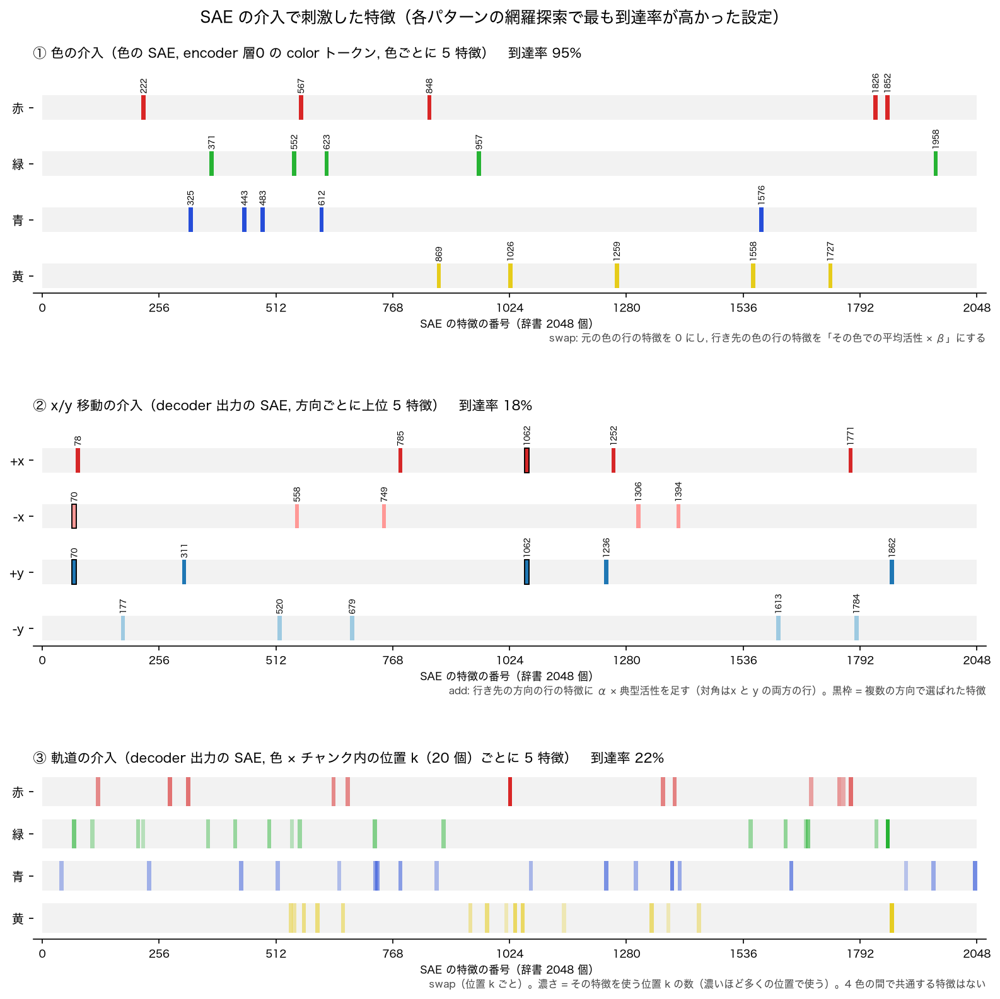

色の介入では、色ごとに互いに重ならない 5 個の特徴が選ばれ、それぞれが1つの色だけで発火する。x/y 移動の介入では、同じ特徴が複数の方向で選ばれている（黒枠。特徴 1062 は +x と +y、特徴 70 は −x と +y）。つまり、1つの特徴が x 軸や y 軸に沿った動きだけを表しているわけではなく、斜めの動きを表す特徴が多い。軌道の介入では、チャンク内の位置 k ごとに別の特徴が選ばれ、1色あたり 12〜18 個の特徴に分散している。すべての位置 k（またはほぼすべて）で使われる特徴は、赤・緑・黄で 1 個ずつしかなく、青では最も多い特徴でも 11 か所だった。

### 4.3 考察: 色の介入と、x/y・軌道の介入で成功率が違った理由

色の特徴に介入したときは 95〜100% の確率でキューブを行き先の箱に入れられたのに対し、x/y 移動と軌道の特徴に介入したときの到達率は 17〜35% にとどまった。この差の要因としては、次の4つが考えられる。1つ目と2つ目は x/y と軌道の両方に、3つ目は x/y に、4つ目は軌道に当てはまる。

**1つ目の要因は、色（目的）がタスクの動作と強く結びついているため、移動方向や軌道の特徴を刺激しても、もともと学習していた動作（元の色の箱へ運ぶ）へ戻ってしまうことである。** 方策は「キューブの色 → その色の箱へ運んで置く」という対応だけを学習しており、色の表現が「どこへ向かい、どこで止まって下ろすか」という置き方全体を決めている。x/y や軌道の特徴で手先を押しても、色の表現は元の色のままなので、方策は元の箱へ向かう計画を出し続け、介入と綱引きになる。実際、x/y と軌道の介入では平均 14% のエピソードでキューブが元の箱に戻った。また、運搬中だけ介入して下ろす前に介入を止めると、元の箱に戻る割合は 8.5% から 20% に増えた。介入を止めると、方策はすぐ元の目的へ戻る。

これを、1回の推論で方策が出す行動チャンクで確かめた。color トークンを行き先の色に変えたときに方策が出すチャンクを「行き先の箱へ向かう正解の計画」とし、各介入でチャンクがそれにどれだけ近づくかを測った。色の介入では 81〜89% 近づいたのに対し、x/y の介入では 20〜33%、軌道の SAE の介入では −1% だった。x/y の介入では、手先は行き先の方向へ十分に動く（0.22〜0.28 m）。しかしこれは、今の状態によらない一定の押しにすぎず、「箱の上で減速して下ろす」という行き先に合った計画にはなっていない。色の介入では encoder の入力側を差し替えるので、cross-attention を通じて decoder のすべての層の計算が変わり、今の状態に合った行き先の箱への計画がそのまま出てくる。

**2つ目の要因は、デモの動作において、手先が動く方向と大きさに偏りがあったことである。** キューブは右側（y = −0.15）にあり、箱はすべて左側（y = 0.10 または 0.24）にあるので、デモでは把持後に手先がほぼ必ず +y 方向（左）へ大きく動く。運搬中に手先が動く向きは 80% の時刻で +y 方向で、−y 方向（右）は 3% の時刻しかなかった。また、1ステップあたりの移動量も、y 方向（左右、平均 7.0 mm）が x 方向（前後、平均 1.9 mm）の約 3.7 倍で、±x 方向の動きは運搬の中で小さな割合しか占めていない。そのため、「+y へ動く」特徴は学習でよく表現されているが、「−y へ動く」特徴はほとんど表現されておらず、「±x へ動く」特徴も弱い。

例えば、青いキューブを青い箱（y = 0.24）に入れる動作に介入して、右側（−y 方向）にある赤い箱（y = 0.10）に入れる場合を考える。このとき方策は、いつもより早く左への運搬を止める必要があり、介入では手先を −y 方向（右）へ押し戻すことになる。しかし、デモにはこうした右への動きがほとんどないので、方策は右へ押される状態をほぼ経験しておらず、押し戻しが元の箱へ向かう動きに負けるか、ある強さを超えると動作が崩れてしまう。逆に、赤いキューブを青い箱に入れる場合は、いつもの左への運搬をさらに先まで続ければよいので、介入が効きやすい。同じように、前後（±x 方向）にずらす場合も、デモの中で x 方向の動きが小さいため、+y 方向に比べて成功率が低かった。網羅探索の中で方向ごとに最も高かった到達率を比べると、x/y の介入では +y 方向（左）が 70〜90% だったのに対し、+x 方向（奥）は 50〜60%、−y 方向（右）は 10〜20% にとどまった。

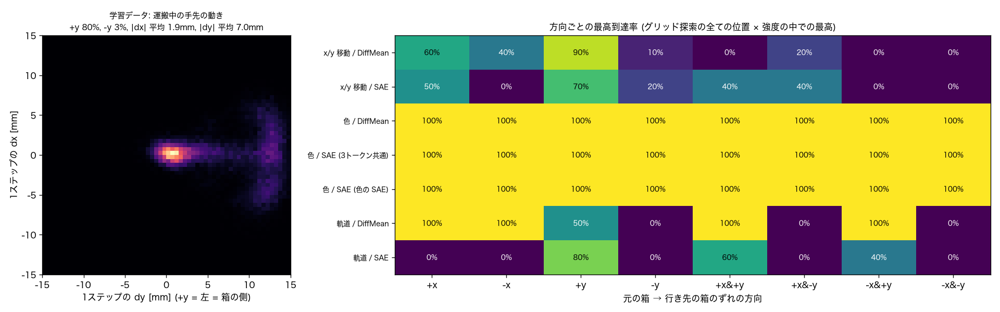

**3つ目の要因（x/y）は、probing で選んだ x/y の特徴が、x 軸や y 軸に沿った動きだけを表していないことである。**

まず、個々の特徴については、probing と steering はよく一致していた。特徴ごとに、(a) データ上でその特徴が強く発火するときに手先がどちらへ動いているか（probing で見た向き）と、(b) その特徴を刺激したときに実際に手先がどちらへ動くか（steering で見た向き）を比べると、両者の向きの cos 類似度は 0.88〜0.99 だった。つまり、データから「左奥へ動く」と読み取れた特徴は、刺激してもほぼそのとおり左奥へ動く。

問題は、そもそも「前後（x 方向）だけに動く」特徴が1つもなかったことである。デモの運搬ではほぼ常に +y（左）への動きが伴うので、「+x（奥）へ動くとき」に発火する特徴を選んでも、その特徴は同時に左への動きも表している。例えば特徴 1062 の向きは (x, y) = (0.53, 0.46) で、奥と左の両方へほぼ同じだけ動く斜めの特徴であり、+x と +y の両方の上位に入っていた（4.2 節の図の黒枠）。従来の方法では、こうした斜めの特徴を「+x の上位3つ」として独立に選んで刺激していたので、y 方向の成分が足し合わさり、奥へ動かしたいのに左へも動いてしまっていた。

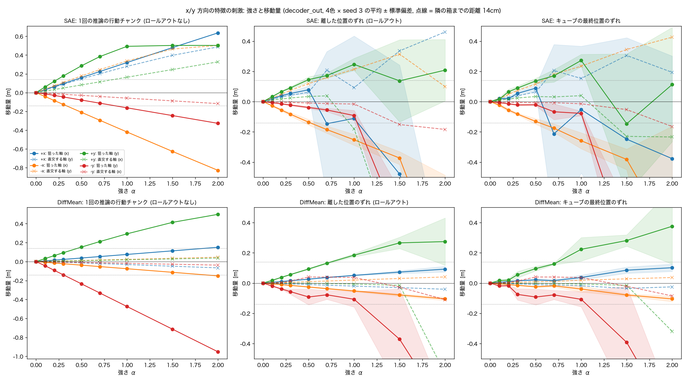

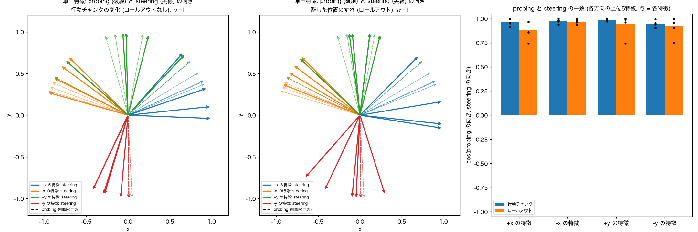

**4つ目の要因（軌道）は、decoder に「4パターンの軌道」そのものに対応する特徴がなく、軌道が x 成分と y 成分の足し算として、状態に応じて値が変わる形で表現されていたことである。** 行き先の情報自体は decoder の活性から線形に約 100% 読み出せたが、色ごとに選んだ 20 特徴からは 59〜73% しか読み出せなかった。反実仮想（color だけを変えた実行）との差と勾配で、行き先を因果的に担う特徴を選び直すと、decoder 出力の約 50 特徴（2048 中）を状態に応じた値に差し替えれば軌道が 90% 切り替わった。しかし、同じ特徴を決まった値に固定すると 2〜8% にとどまった。また、4パターンの違いは、関節角度でも内部表現でも「x の行き先 + y の行き先」の足し算でほぼ説明でき、パターン固有の部分は関節角度で 0.6%、decoder で 4〜13% しかなかった。つまり、軌道の特徴を見つけること（probing）はできても、決まった値で刺激して軌道全体を切り替えること（steering）はできない。probing と steering のギャップが、小さな動作生成モデルでもはっきり現れた。

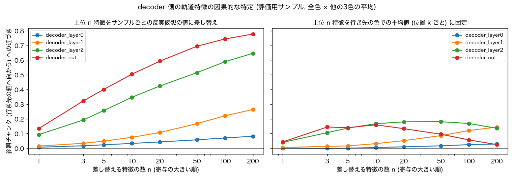

以上の要因から、次の2つの改善案が考えられる。

- **改善案A（1つ目の要因に対応）**: 色の特徴を抑えて、元の箱へ戻ろうとする力をなくしたうえで、x/y 移動や軌道の特徴を刺激する。
- **改善案B（3つ目の要因に対応）**: probing した x と y の移動の特徴を同時に刺激し、x（前後）の特徴に含まれる y（左右）方向の成分を他の特徴で打ち消して、狙った軸以外へのずれを補正する。あわせて、軸ごとに必要な強さが違うので、強さも軸ごとに合わせる。

2つ目の要因（動作の方向の偏り）はデモそのものに由来するので、介入だけでは直せない。4つ目の要因から、軌道は決まった値の刺激では切り替えられないと分かったので、5章の追加実験では x/y 移動の介入に絞って、2つの改善案を検証した。

## 5. 追加実験: x/y 移動の介入の改善

この章では x/y 移動（x: 前後、y: 左右）の介入だけを対象にして、4.3 節の改善案B（特徴の組み合わせによる補正）と改善案A（色の特徴の抑制）を検証した。どちらも、評価には調整に使っていない seed（100〜119）を使い、4色 × 他の3色の箱の 12 通り × 20 エピソードで到達率を測った。

### 5.1 改善案B: x/y の特徴を組み合わせて、軸からのずれを補正する

次の手順で改善した。まず、特徴を組み合わせて選んだ。手先の移動に強く寄与する 20 個の候補特徴から、7次元すべての行動成分（位置・回転・グリッパー）について、狙った軸以外の成分が 0 になる重みの組み合わせを NNLS（非負最小二乗）で求めた。これで、例えば「+x（奥）の特徴に含まれる +y（左）の成分」を、他の特徴の −y（右）の成分で打ち消せる。グリッパーの成分も条件に入れたのは、位置だけを条件にすると、組み合わせにグリッパーを開く成分が混ざり、運搬中にキューブを落としたためである。次に、強さと移動量の比例関係から、14 cm（箱の間隔）動かすのに必要な強さを軸ごとに求めて較正した。さらに、x と y を同時に動かす対角の方向は、x と y の強さの倍率を対ごとに決め、−y を含む方向では下ろし始めたら介入を止めるようにした。

| 条件 | 到達率 |
|---|---|
| 従来の SAE（上位3特徴を独立に選ぶ） | 16% |
| DiffMean | 18% |
| 組み合わせで選ぶ | 32% |
| + 軸ごとに較正 | 52% |
| + 対角の補正・下ろし始めで停止（−y を含む方向のみ） | **58%** |

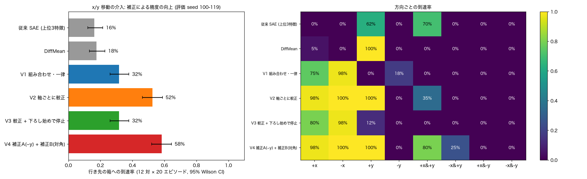

改善案Bにより、到達率は従来の SAE の 16% から 58% に上がり、DiffMean（18%）を大きく上回った。1軸の移動は +x 98%、−x 100%、+y 100% まで届くようになった。組み合わせで選んだ特徴による行動チャンクは、狙った軸から 0.5° 未満しかずれず、従来の上位3特徴（16〜42° のずれ）に比べて軸に沿って動いた。これは、3つ目の要因（特徴が軸に沿っていない）が x/y 介入の失敗の大きな原因だったことを示している。一方、−y を含む方向は、どの補正でも 0% のままだった。方策は運搬の高さで止まったまま、上限の 400 ステップに達して終わった。

### 5.2 改善案A: 色の特徴を抑えたうえで x/y の特徴を刺激する

色の特徴の抑制は encoder 層0 の color トークンで行い、SAE で元の色の特徴を 0 にする方法と、DiffMean で color トークンを4色の平均に置き換える（中立化する）方法を試した。

まず、従来の x/y と軌道の介入に色の抑制を加えた（4080 エピソード）。元の箱に戻る割合は、平均 14.3% から 2.7%（SAE）、1.6%（DiffMean）に下がり、1つ目の要因である「元の箱への引き戻し」はほぼなくなった。しかし、到達率は平均 13.3% から 15〜16% とほとんど上がらず、元の箱に戻っていた分は「どの箱にも入らない」に移った（65% → 76%）。対照として色を抑えるだけ（x/y の刺激なし）にすると、キューブが他の色の箱に入ることは一度もなく、SAE で抑えた場合は約半分が元の箱、残りが箱の外、DiffMean で中立化した場合は 100% が箱の外だった。

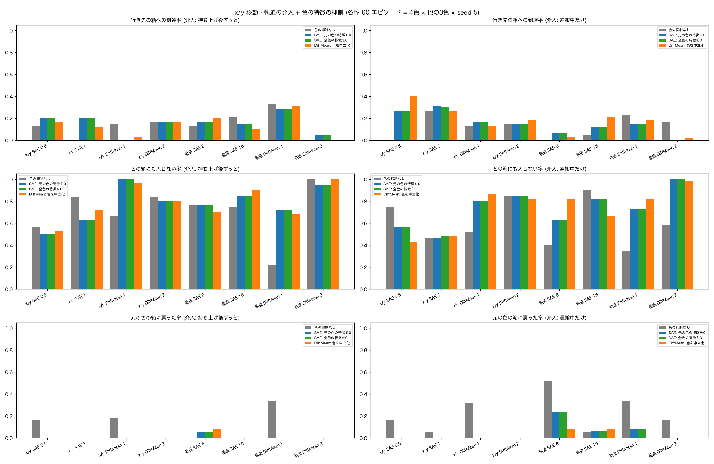

次に、5.1 節で補正した x/y の介入に色の抑制を加えた。

| 条件 | 到達率 | +x | −x | +y | +x&+y | −x&+y | −y を含む方向 |
|---|---|---|---|---|---|---|---|
| 補正した x/y（色の抑制なし） | **58%** | 98% | 100% | 100% | 80% | 25% | 0% |
| + SAE で元の色の特徴を 0 | 46〜48% | 38% | 52% | 85% | **100%** | **100%** | 0〜25% |
| + DiffMean で色を中立化 | 36% | 20% | 50% | 45% | 100% | 100% | 0〜5% |

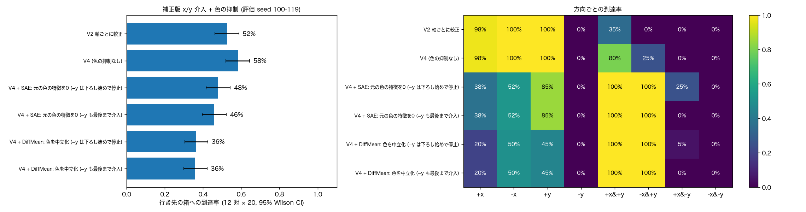

色を抑えると、+y を含む対角の方向は 100% になった（+x&+y は 80% → 100%、−x&+y は 25% → 100%）。一方、1軸の移動は大きく下がり（+x は 98% → 38%、−x は 100% → 52%）、全体の到達率は 58% から 46〜48%（SAE）、36%（DiffMean）にかえって下がった。−y を含む方向は、色を抑えても届かなかった。

### 5.3 考察

改善案Bは有効で、改善案Aは方向によって効果が逆になった。この違いは、**色（目的）の表現が「元の箱へ引き戻す力」であると同時に、「どこで止まって下ろすか」の基準にもなっている**と考えると説明できる。

1軸の移動（+x: 奥、−x: 手前、+y: 左）は、元の箱を通り過ぎる方向や、元の箱と同じ距離を進む方向への移動である。そのため、方策は途中で「目的の位置に着いた」と判断して下ろし始め、x/y の介入はその止まる位置をずらす形で働いていた。改善案Bで軸に沿って押せるようになると、この方向にはほぼ確実に届いた。ところが色を抑えると、この「着いた」という判断の基準がなくなるので、止まる位置が狂い、1軸の移動の到達率が下がった。逆に +y を含む対角では、y 方向の押しが大きく、元の箱への引き戻しと綱引きになっていたので、色を抑えて引き戻しをなくすと、押しのとおりに進んで下ろせるようになった。

−y（右）を含む方向は、いつもの +y 方向（左）への運搬を途中で止めて、元の箱に着く前に置く必要がある。方策は自分の目的（元の箱）に着かない限り置く動作を始めず、x/y の特徴で引き止めると運搬の高さで止まったままになる。色を抑えても止まったままだったので、−y で置けないのは元の色との綱引きだけが原因ではなく、置く判断をするための手がかり（目的）がないためと考えられる。

まとめると、運動レベル（x/y）の介入は、目的（色）が決める止まる位置を前提に、それをずらす形でしか働かず、目的そのものの代わりにはならない。行き先を自在に変えられたのは、目的（色）の表現そのものを別の色に差し替える介入だけだった。

SAE と DiffMean を比べると、色の介入では DiffMean（100%）が SAE（95%）をわずかに上回った。一方、x/y の介入では、SAE の特徴を組み合わせることで DiffMean（18%）を大きく上回った（58%）。DiffMean は2群の差という1本の方向しか使えないのに対し、SAE は行動の成分ごとに特徴を分解し、狙った方向だけに効く組み合わせを作れる点に利点があった。

本研究には限界もある。色と行き先は常に1対1で、箱の配置も固定（方策は箱を観測していない）なので、色の特徴が「色の識別」なのか「箱 c 行き」なのかはデータから区別できない。また、介入するタイミングの判定にシミュレータの真の状態を使っている。結論は、2×2 の4パターン、Temporal Ensembling なし、辞書 2048 の TopK SAE という条件でのものである。

## 6. 工夫した点、うまくいかなかった点と反省

### 工夫した点

1つ目に、「色 / x/y / 軌道」の3種類の介入を SAE と DiffMean で同じ条件で比べ、位置・強度・特徴数を網羅的に探索して到達率の上限を示した。2つ目に、x/y と軌道の介入が効かなかった理由を、手先が動く方向の大きさの偏り、行動チャンクの直接比較、反実仮想による因果的な特徴選択、関節角度の分解によって切り分けた。3つ目に、その分析から改善案を立て、x/y の介入を特徴の組み合わせ選択（グリッパーなど他の成分の混入の除去を含む）と較正によって 16% から 58% に改善し、残る失敗（−y）の理由も示した。4つ目に、調整と評価で seed を分け、結果を合わせ込まないようにした。

### うまくいかなかった点と反省

最初は別の仕様書（MimicGen データ版）で作業を始めてしまい、時間を失った。また、x/y（前後・左右）の移動の特徴を「上位3つを独立に選ぶ」方法で選んでいたため、斜めの特徴が足し合わさり、最初は運動レベルの介入を過小評価していた。特徴の組み合わせを選ぶときも、最初は位置しか条件にしておらず、グリッパーの成分が混ざってキューブを落としてしまった。

−y 方向（右。元の箱に着く前に置く方向）は、運動レベルの介入だけでは解決できなかった。方策の「着いたら下ろす」という判断に介入する方法（目的の表現と組み合わせるなど）は今後の課題である。また、色と行き先を切り分けるには、箱の配置を入れ替えたり画像入力にしたりする設定が必要だった。

## 引用

- Y. Zhu et al., "robosuite: A Modular Simulation Framework and Benchmark for Robot Learning," arXiv:2009.12293.
- T. Z. Zhao, V. Kumar, S. Levine, C. Finn, "Learning Fine-Grained Bimanual Manipulation with Low-Cost Hardware," RSS 2023.
- E. Todorov, T. Erez, Y. Tassa, "MuJoCo: A physics engine for model-based control," IROS 2012.
- L. Gao et al., "Scaling and evaluating sparse autoencoders," arXiv:2406.04093.
- A. Templeton et al., "Scaling Monosemanticity: Extracting Interpretable Features from Claude 3 Sonnet," Transformer Circuits Thread, 2024.
- S. Marks, M. Tegmark, "The Geometry of Truth: Emergent Linear Structure in Large Language Model Representations of True/False Datasets," arXiv:2310.06824.
- Z. Wu et al., "AxBench: Steering LLMs? Even Simple Baselines Outperform Sparse Autoencoders," arXiv:2501.17148.
- B. Bussmann et al., "Learning Multi-Level Features with Matryoshka Sparse Autoencoders," arXiv:2503.17547.
- B. Häon et al., "Mechanistic interpretability for steering vision-language-action models," CoRL 2025, arXiv:2509.00328.
- A. Swann et al., "Sparse Autoencoders Reveal Interpretable and Steerable Features in VLA Models," arXiv:2603.19183.
- X. Jin et al., "Event-Grounded Sparse Autoencoders for Vision-Language-Action Policies," arXiv:2605.17204.
